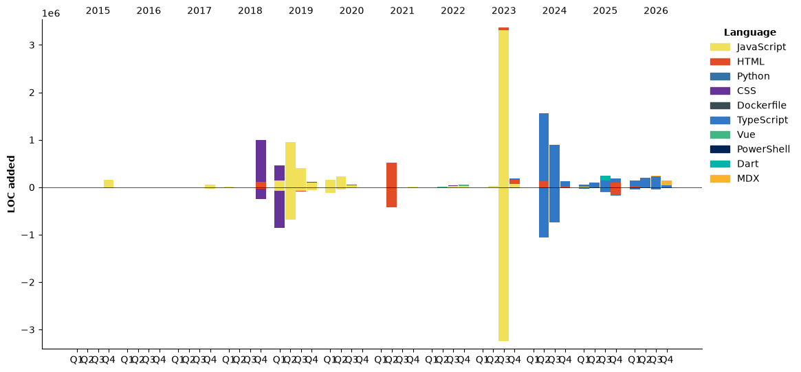

# Hello! I'm yoonu 

<a href="https://github.com/devxb/gitanimals">
  
  
</a> 

<!----> 
<div align="center">
<!--   길드가입했지롱 -->
  <a href="https://www.gitanimals.org/">
      
    </a>
<!--   <a href="https://github.com/devxb/gitanimals">
    
  </a> -->
</div>

-------------

[](https://hits.seeyoufarm.com)

<!--START_SECTION:waka-->


**🐱 저의 GitHub 정보에요.** 

> 📦 GitHub의 720.2 kB만큼의 저장소를 사용하고 있어요. 
 > 
> 🏆 921 만큼의 Contributions을 2026년에 했어요
 > 
> 💼 구직중이에요.
 > 
> 📜 67개의 Public Repository를 만들었어요. 
 > 
> 🔑 47개의 Private Repository를 만들었어요. 
 > 
**저는 저녁형 인간이에요. 🦉** 

```text
🌞 아침                     552 commits         ⣿⣀⣀⣀⣀⣀⣀⣀⣀⣀⣀⣀⣀⣀⣀⣀⣀⣀⣀⣀⣀⣀⣀⣀⣀   03.61 % 
🌆 낮　                     3718 commits        ⣿⣿⣿⣿⣿⣿⣀⣀⣀⣀⣀⣀⣀⣀⣀⣀⣀⣀⣀⣀⣀⣀⣀⣀⣀   24.28 % 
🌃 저녁                     5637 commits        ⣿⣿⣿⣿⣿⣿⣿⣿⣿⣀⣀⣀⣀⣀⣀⣀⣀⣀⣀⣀⣀⣀⣀⣀⣀   36.82 % 
🌙 밤　                     5404 commits        ⣿⣿⣿⣿⣿⣿⣿⣿⣿⣀⣀⣀⣀⣀⣀⣀⣀⣀⣀⣀⣀⣀⣀⣀⣀   35.29 % 
```
📅 **제가 가장 생산적인 날은 목요일이에요.** 

```text
월요일                      2100 commits        ⣿⣿⣿⣀⣀⣀⣀⣀⣀⣀⣀⣀⣀⣀⣀⣀⣀⣀⣀⣀⣀⣀⣀⣀⣀   13.72 % 
화요일                      2517 commits        ⣿⣿⣿⣿⣀⣀⣀⣀⣀⣀⣀⣀⣀⣀⣀⣀⣀⣀⣀⣀⣀⣀⣀⣀⣀   16.44 % 
수요일                      2622 commits        ⣿⣿⣿⣿⣀⣀⣀⣀⣀⣀⣀⣀⣀⣀⣀⣀⣀⣀⣀⣀⣀⣀⣀⣀⣀   17.12 % 
목요일                      2692 commits        ⣿⣿⣿⣿⣀⣀⣀⣀⣀⣀⣀⣀⣀⣀⣀⣀⣀⣀⣀⣀⣀⣀⣀⣀⣀   17.58 % 
금요일                      2050 commits        ⣿⣿⣿⣀⣀⣀⣀⣀⣀⣀⣀⣀⣀⣀⣀⣀⣀⣀⣀⣀⣀⣀⣀⣀⣀   13.39 % 
토요일                      1863 commits        ⣿⣿⣿⣀⣀⣀⣀⣀⣀⣀⣀⣀⣀⣀⣀⣀⣀⣀⣀⣀⣀⣀⣀⣀⣀   12.17 % 
일요일                      1467 commits        ⣿⣿⣀⣀⣀⣀⣀⣀⣀⣀⣀⣀⣀⣀⣀⣀⣀⣀⣀⣀⣀⣀⣀⣀⣀   09.58 % 
```


📊 **저는 이번주를 이렇게 시간을 보냈어요.** 

```text
💬 프로그래밍 언어들: 
Markdown                 4 hrs 40 mins       ⣿⣿⣿⣿⣿⣿⣿⣿⣀⣀⣀⣀⣀⣀⣀⣀⣀⣀⣀⣀⣀⣀⣀⣀⣀   32.35 % 
Other                    3 hrs 49 mins       ⣿⣿⣿⣿⣿⣿⣿⣀⣀⣀⣀⣀⣀⣀⣀⣀⣀⣀⣀⣀⣀⣀⣀⣀⣀   26.51 % 
MDX                      3 hrs 26 mins       ⣿⣿⣿⣿⣿⣿⣀⣀⣀⣀⣀⣀⣀⣀⣀⣀⣀⣀⣀⣀⣀⣀⣀⣀⣀   23.81 % 
JavaScript               1 hr 40 mins        ⣿⣿⣿⣀⣀⣀⣀⣀⣀⣀⣀⣀⣀⣀⣀⣀⣀⣀⣀⣀⣀⣀⣀⣀⣀   11.65 % 
YAML                     48 mins             ⣿⣀⣀⣀⣀⣀⣀⣀⣀⣀⣀⣀⣀⣀⣀⣀⣀⣀⣀⣀⣀⣀⣀⣀⣀   05.55 % 

🔥 에디터들: 
Codex CLI                5 hrs 12 mins       ⣿⣿⣿⣿⣿⣿⣿⣿⣿⣀⣀⣀⣀⣀⣀⣀⣀⣀⣀⣀⣀⣀⣀⣀⣀   36.11 % 
Codex Exec               3 hrs 59 mins       ⣿⣿⣿⣿⣿⣿⣿⣀⣀⣀⣀⣀⣀⣀⣀⣀⣀⣀⣀⣀⣀⣀⣀⣀⣀   27.64 % 
Codex Vscode             3 hrs 8 mins        ⣿⣿⣿⣿⣿⣀⣀⣀⣀⣀⣀⣀⣀⣀⣀⣀⣀⣀⣀⣀⣀⣀⣀⣀⣀   21.72 % 
Antigravity IDE          2 hrs 5 mins        ⣿⣿⣿⣿⣀⣀⣀⣀⣀⣀⣀⣀⣀⣀⣀⣀⣀⣀⣀⣀⣀⣀⣀⣀⣀   14.53 % 
```

🤖 **AI Coding This Week** 

```text
⏱ AI Coding Time: 13 hrs 15 mins (91.86%)

✍️ 3,087 lines written by AI, 100 lines written by hand (96.86% AI-written)

🔤 16,593,970 Input Tokens, 844,445 Output Tokens

💵 $76.53 Estimated AI Cost This Week

🧠 189 AI Sessions, 395 AI Prompts

GPT                      3,508 lines         ⣿⣿⣿⣿⣿⣿⣿⣿⣿⣿⣿⣿⣿⣿⣿⣿⣿⣿⣿⣿⣿⣿⣿⣿⣿   100.00 % 

🔎 AI Coding Insights:
🤖 AI-Driven — 96.86% of written lines came from AI
📄 Detailed Prompter — average 1,220 characters per prompt
🔁 Iterative Prompter — average 2 prompts per session
🚀 High AI Trust — 3.12% of changed lines were hand-edited
```

**저는 주로 JavaScript 언어를 사용해요.** 

```text
TypeScript               23 repos            ⣿⣿⣿⣿⣿⣿⣿⣀⣀⣀⣀⣀⣀⣀⣀⣀⣀⣀⣀⣀⣀⣀⣀⣀⣀   29.49 % 
HTML                     9 repos             ⣿⣿⣿⣀⣀⣀⣀⣀⣀⣀⣀⣀⣀⣀⣀⣀⣀⣀⣀⣀⣀⣀⣀⣀⣀   11.54 % 
CSS                      8 repos             ⣿⣿⣿⣀⣀⣀⣀⣀⣀⣀⣀⣀⣀⣀⣀⣀⣀⣀⣀⣀⣀⣀⣀⣀⣀   10.26 % 
Dockerfile               2 repos             ⣿⣀⣀⣀⣀⣀⣀⣀⣀⣀⣀⣀⣀⣀⣀⣀⣀⣀⣀⣀⣀⣀⣀⣀⣀   02.56 % 
MDX                      1 repo              ⣀⣀⣀⣀⣀⣀⣀⣀⣀⣀⣀⣀⣀⣀⣀⣀⣀⣀⣀⣀⣀⣀⣀⣀⣀   01.28 % 
```


**타임라인**




 Last Updated on 28/11/2026 01:38:52 UTC
<!--END_SECTION:waka-->


<!--A+ test -->
<!---->


<!--**yoonucho/yoonucho** is a ✨ _special_ ✨ repository because its `README.md` (this file) appears on your GitHub profile.

Here are some ideas to get you started:

- 🔭 I’m currently working on ...
- 🌱 I’m currently learning ...
- 👯 I’m looking to collaborate on ...
- 🤔 I’m looking for help with ...
- 💬 Ask me about ...
- 📫 How to reach me: ...
- 😄 Pronouns: ...
- ⚡ Fun fact: ...
-->

