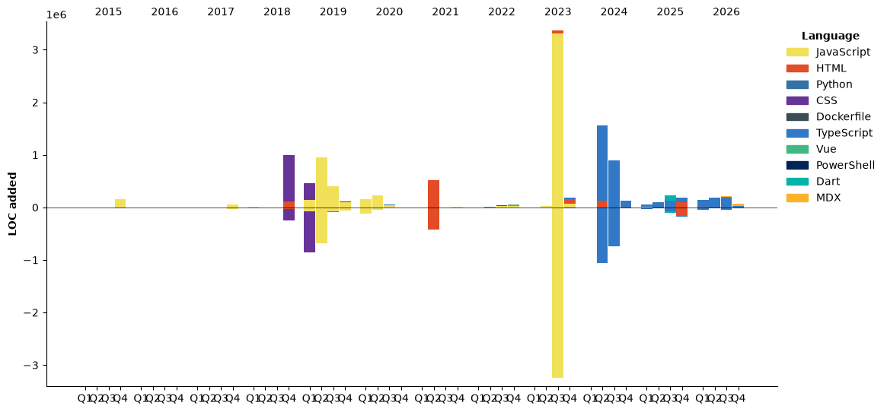

# Hello! I'm yoonu 

<a href="https://github.com/devxb/gitanimals">
  
  
</a> 

<!----> 
<div align="center">
<!--   길드가입했지롱 -->
  <a href="https://www.gitanimals.org/">
      
    </a>
<!--   <a href="https://github.com/devxb/gitanimals">
    
  </a> -->
</div>

-------------

[](https://hits.seeyoufarm.com)

<!--START_SECTION:waka-->


**🐱 저의 GitHub 정보에요.** 

> 📦 GitHub의 719.0 kB만큼의 저장소를 사용하고 있어요. 
 > 
> 🏆 845 만큼의 Contributions을 2026년에 했어요
 > 
> 💼 구직중이에요.
 > 
> 📜 64개의 Public Repository를 만들었어요. 
 > 
> 🔑 48개의 Private Repository를 만들었어요. 
 > 
**저는 저녁형 인간이에요. 🦉** 

```text
🌞 아침                     551 commits         ⣿⣀⣀⣀⣀⣀⣀⣀⣀⣀⣀⣀⣀⣀⣀⣀⣀⣀⣀⣀⣀⣀⣀⣀⣀   03.71 % 
🌆 낮　                     3651 commits        ⣿⣿⣿⣿⣿⣿⣀⣀⣀⣀⣀⣀⣀⣀⣀⣀⣀⣀⣀⣀⣀⣀⣀⣀⣀   24.59 % 
🌃 저녁                     5439 commits        ⣿⣿⣿⣿⣿⣿⣿⣿⣿⣀⣀⣀⣀⣀⣀⣀⣀⣀⣀⣀⣀⣀⣀⣀⣀   36.64 % 
🌙 밤　                     5205 commits        ⣿⣿⣿⣿⣿⣿⣿⣿⣿⣀⣀⣀⣀⣀⣀⣀⣀⣀⣀⣀⣀⣀⣀⣀⣀   35.06 % 
```
📅 **제가 가장 생산적인 날은 목요일이에요.** 

```text
월요일                      2020 commits        ⣿⣿⣿⣀⣀⣀⣀⣀⣀⣀⣀⣀⣀⣀⣀⣀⣀⣀⣀⣀⣀⣀⣀⣀⣀   13.61 % 
화요일                      2420 commits        ⣿⣿⣿⣿⣀⣀⣀⣀⣀⣀⣀⣀⣀⣀⣀⣀⣀⣀⣀⣀⣀⣀⣀⣀⣀   16.30 % 
수요일                      2528 commits        ⣿⣿⣿⣿⣀⣀⣀⣀⣀⣀⣀⣀⣀⣀⣀⣀⣀⣀⣀⣀⣀⣀⣀⣀⣀   17.03 % 
목요일                      2609 commits        ⣿⣿⣿⣿⣀⣀⣀⣀⣀⣀⣀⣀⣀⣀⣀⣀⣀⣀⣀⣀⣀⣀⣀⣀⣀   17.57 % 
금요일                      1996 commits        ⣿⣿⣿⣀⣀⣀⣀⣀⣀⣀⣀⣀⣀⣀⣀⣀⣀⣀⣀⣀⣀⣀⣀⣀⣀   13.44 % 
토요일                      1826 commits        ⣿⣿⣿⣀⣀⣀⣀⣀⣀⣀⣀⣀⣀⣀⣀⣀⣀⣀⣀⣀⣀⣀⣀⣀⣀   12.30 % 
일요일                      1447 commits        ⣿⣿⣀⣀⣀⣀⣀⣀⣀⣀⣀⣀⣀⣀⣀⣀⣀⣀⣀⣀⣀⣀⣀⣀⣀   09.75 % 
```


📊 **저는 이번주를 이렇게 시간을 보냈어요.** 

```text
💬 프로그래밍 언어들: 
Markdown                 13 hrs 31 mins      ⣿⣿⣿⣿⣿⣿⣿⣿⣿⣿⣀⣀⣀⣀⣀⣀⣀⣀⣀⣀⣀⣀⣀⣀⣀   41.28 % 
TypeScript               10 hrs 52 mins      ⣿⣿⣿⣿⣿⣿⣿⣿⣀⣀⣀⣀⣀⣀⣀⣀⣀⣀⣀⣀⣀⣀⣀⣀⣀   33.18 % 
Other                    3 hrs 1 min         ⣿⣿⣀⣀⣀⣀⣀⣀⣀⣀⣀⣀⣀⣀⣀⣀⣀⣀⣀⣀⣀⣀⣀⣀⣀   09.23 % 
MDX                      2 hrs 36 mins       ⣿⣿⣀⣀⣀⣀⣀⣀⣀⣀⣀⣀⣀⣀⣀⣀⣀⣀⣀⣀⣀⣀⣀⣀⣀   07.98 % 
JavaScript               1 hr 7 mins         ⣿⣀⣀⣀⣀⣀⣀⣀⣀⣀⣀⣀⣀⣀⣀⣀⣀⣀⣀⣀⣀⣀⣀⣀⣀   03.41 % 

🔥 에디터들: 
Codex CLI                30 hrs 45 mins      ⣿⣿⣿⣿⣿⣿⣿⣿⣿⣿⣿⣿⣿⣿⣿⣿⣿⣿⣿⣿⣿⣿⣿⣀⣀   93.87 % 
VS Code                  56 mins             ⣿⣀⣀⣀⣀⣀⣀⣀⣀⣀⣀⣀⣀⣀⣀⣀⣀⣀⣀⣀⣀⣀⣀⣀⣀   02.90 % 
Antigravity IDE          56 mins             ⣿⣀⣀⣀⣀⣀⣀⣀⣀⣀⣀⣀⣀⣀⣀⣀⣀⣀⣀⣀⣀⣀⣀⣀⣀   02.88 % 
Codex Exec               4 mins              ⣀⣀⣀⣀⣀⣀⣀⣀⣀⣀⣀⣀⣀⣀⣀⣀⣀⣀⣀⣀⣀⣀⣀⣀⣀   00.21 % 
Codex Vscode             2 mins              ⣀⣀⣀⣀⣀⣀⣀⣀⣀⣀⣀⣀⣀⣀⣀⣀⣀⣀⣀⣀⣀⣀⣀⣀⣀   00.14 % 
```

🤖 **AI Coding This Week** 

```text
⏱ AI Coding Time: 32 hrs 13 mins (98.32%)

✍️ 7,254 lines written by AI, 5 lines written by hand (99.93% AI-written)

🔤 53,388,317 Input Tokens, 6,152,129 Output Tokens

💵 $31.62 Estimated AI Cost This Week

🧠 27 AI Sessions, 530 AI Prompts

GPT                      7,615 lines         ⣿⣿⣿⣿⣿⣿⣿⣿⣿⣿⣿⣿⣿⣿⣿⣿⣿⣿⣿⣿⣿⣿⣿⣿⣿   100.00 % 

🔎 AI Coding Insights:
🤖 AI-Driven — 99.93% of written lines came from AI
📄 Detailed Prompter — average 524 characters per prompt
🔁 Iterative Prompter — average 20 prompts per session
🚀 High AI Trust — 0.07% of changed lines were hand-edited
```

**저는 주로 JavaScript 언어를 사용해요.** 

```text
TypeScript               23 repos            ⣿⣿⣿⣿⣿⣿⣿⣿⣀⣀⣀⣀⣀⣀⣀⣀⣀⣀⣀⣀⣀⣀⣀⣀⣀   30.26 % 
HTML                     9 repos             ⣿⣿⣿⣀⣀⣀⣀⣀⣀⣀⣀⣀⣀⣀⣀⣀⣀⣀⣀⣀⣀⣀⣀⣀⣀   11.84 % 
Python                   2 repos             ⣿⣀⣀⣀⣀⣀⣀⣀⣀⣀⣀⣀⣀⣀⣀⣀⣀⣀⣀⣀⣀⣀⣀⣀⣀   02.63 % 
MDX                      1 repo              ⣀⣀⣀⣀⣀⣀⣀⣀⣀⣀⣀⣀⣀⣀⣀⣀⣀⣀⣀⣀⣀⣀⣀⣀⣀   01.32 % 
Dart                     1 repo              ⣀⣀⣀⣀⣀⣀⣀⣀⣀⣀⣀⣀⣀⣀⣀⣀⣀⣀⣀⣀⣀⣀⣀⣀⣀   01.32 % 
```


**타임라인**




 Last Updated on 06/11/2026 23:27:30 UTC
<!--END_SECTION:waka-->


<!--A+ test -->
<!---->


<!--**yoonucho/yoonucho** is a ✨ _special_ ✨ repository because its `README.md` (this file) appears on your GitHub profile.

Here are some ideas to get you started:

- 🔭 I’m currently working on ...
- 🌱 I’m currently learning ...
- 👯 I’m looking to collaborate on ...
- 🤔 I’m looking for help with ...
- 💬 Ask me about ...
- 📫 How to reach me: ...
- 😄 Pronouns: ...
- ⚡ Fun fact: ...
-->

